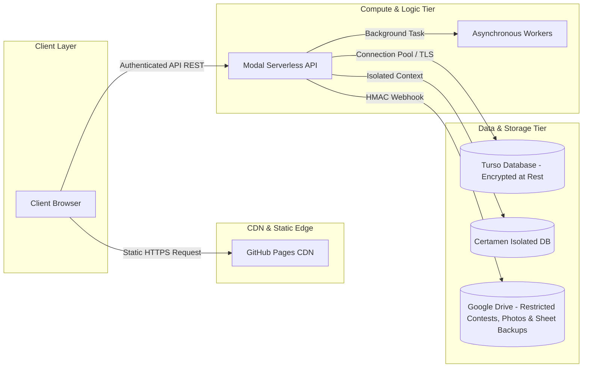

# Data Privacy, Security & Regulatory Compliance Specification

**Platform:** 72nd Annual CAJCL State Convention Platform (`state.uhsjcl.org`)  
**Operator:** California Junior Classical League (CAJCL), 501(c)(3) Non-Profit  
**Document Classification:** Regulatory & Operational Compliance Specification  
**Applicable Legal Frameworks:** COPPA (16 CFR Part 312), FERPA (34 CFR Part 99), SOPIPA (Cal. Bus. & Prof. Code § 22584), AB 1584 (Cal. Educ. Code § 49073.1), Cal. Civ. Code §§ 1798.81.5 & 1798.82  

---

## 1. Executive Summary & Governance Scope

This document defines the data privacy safeguards, architectural security boundaries, and regulatory compliance posture for the CAJCL State Convention digital platform under the **Parental-Consent-Gated Single-System Architecture** approved by CAJCL leadership (superseded prior ID-only proposals).

To run the convention cleanly in a single system, the platform stores the minimum attendee information needed (name, school/chapter, grade, Latin level, meal preference, and event selections) **strictly after verifiable parental consent** is collected on the updated **CAJCL Student Waiver and Permission Form**. Students without parental consent cannot attend and must not be given a chapter Join Code.

### Statutory Applicability Matrix

| Regulatory Framework | Jurisdiction / Entity Threshold | Platform Applicability Determination | Compliance Strategy |
| :--- | :--- | :--- | :--- |
| **COPPA** (16 CFR Part 312) | Operators collecting PII online from children under 13. Excludes 501(c)(3) entities under FTC Act §5. | **Voluntary Full Adherence:** Middle school delegates include students aged 11–12. CAJCL enforces COPPA standards as industry best practice. | Explicit parental consent clause on physical CAJCL Waiver **required before** distributing chapter Join Codes; zero student emails/phones/DOBs/addresses; dual-layer photo metadata stripping; April 12, 2027 purge. |
| **FERPA** (34 CFR Part 99) | Educational agencies receiving federal funding. | **Parental Consent & Role Isolation:** Student data is collected for CAJCL convention administration with explicit parent/guardian consent on the CAJCL Waiver. | Strict chapter tenancy isolation (sponsors see only their own students; logged-in students see only themselves; convention hosts see all; public sees zero student names); no commercial redisclosure. |
| **SOPIPA** (Cal. Bus. & Prof. Code § 22584) | Operators of sites designed, marketed, and used primarily for K–12 school purposes. | **Mandatory Compliance:** The system directly administers interscholastic K–12 academic competition activities. | Strict ban on selling data, targeted advertising, or commercial profiling; vetted infrastructure providers (Modal & Turso approved; other tools require adult sign-off); 10-day backup expiration and April 12, 2027 purge. |
| **AB 1584** (Cal. Educ. Code § 49073.1) | Contracts between California LEAs (school districts) and third-party digital providers. | **Standard Addendum Availability:** Provides required statutory terms in the Privacy Policy for participating districts. | Standard student records addendum incorporated into Privacy Policy (§10); aligned with CAJCL's official Privacy Policy authored by CAJCL State Co-Chair Fred Muth. |

---

## 2. End-to-End Data Flow Architecture

### Data Flow Lifecycle Stages
1. **Public Browsing:** Anonymous visitors access pre-rendered HTML/CSS from GitHub Pages CDN. Public pages expose **only** the convention schedule, map, informational pages, and pre-aggregated integer counts (`/public/stats`) — **never** student names or public awards lists. Public links are distributed via physical QR codes or emails to registered attendees, not widely on social media.
2. **Authentication & Sponsor One-Time Codes:** Attendees enter their login token (`PPP-XXXXX-XXXXX`). Modal validates against `HMAC-SHA256(pepper, code)` in Turso. To secure student data, **chapter sponsors receive a one-time verification code each time they sign in** (and adult/admin 2FA policy is documented in `docs/SECURITY.md`). On success, a 256-bit cryptographically secure session token is issued; only its SHA-256 hash is retained.
3. **Consent-Gated Join Code Registration:** Sponsors first distribute and collect signed paper **Medical Forms** (all attendees) and **CAJCL Waivers** (students only, containing parental consent for online data use). **Only after a student's waiver and medical form are submitted** does the sponsor distribute the chapter Join Code sheet (also specified in the Convention Book for adults: SCL, Sponsors, and Chaperones). Students enter their name, grade, and Latin level; once set, **only the sponsor can change those details**. Sponsors can observe and edit all student-entered data, approve/remove students, reset their join code, and enable/disable joining.
4. **Digital Activity Sheets & Deadlines:** Registration opens **December 1, 2026**. Activity sheets lock after **February 13, 2027**. Substitutions are permitted through **February 26, 2027** (with updated paper forms mailed or brought to Friday check-in).
5. **Digital Contest Uploads:** Pre-convention creative submissions (Digital Art/Poster, Latin Slogan, English Slogan, Modern Myth, Original Poetry), Scrapbook Pictures, and Publicity Portfolio are due **March 6, 2027** on the website (Digital Scrapbook due **March 13 at 10:00 AM**). Files transmit via Modal to Google Drive via an authenticated webhook puppet.
5a. **At-Convention Photo Contest:** During convention, delegates may upload one photo per open category (`#/photos`), with an optional caption, from their phone. The browser (`frontend/public/js/pages/photos.js`) re-draws each photo onto an HTML5 canvas (≤2400 px JPEG + 480 px thumbnail), removing location, camera, and time metadata; the server (`backend/lib/photos.py`) verifies magic bytes and strips JPEG `APP1` (EXIF/XMP), `APP13` (IPTC), and `COM` segments as well as PNG `eXIf`, `tEXt`, `iTXt`, `zTXt`, and `tIME` chunks. Only the Activities Chair (`activities` scope) and Convention Presidents see photos inside the portal. A photo is deleted (Drive trash) when withdrawn, taken down, when its category is deleted, or when the student is redacted.
5b. **Olympika Sign-Ups and the Convention Schedule:** Delegates sign up for Olympika events (`#/olympika`). The master convention schedule (`#/schedule`) is public and contains no personal data: Olympika appears on it only as event, heat or round, time, and place.
5c. **Activities Potluck:** The Activities Chair posts activities that need helpers. Attendees tick ones they would help run on their sheet; delegate picks require sponsor approval. Picks are deleted when redacted, and with everything else on April 12, 2027.
6. **Double-Blind Judging:** Evaluators holding the `judge` role access contest files anonymized as `Entry N`. Student names, school chapters, and source filenames are programmatically stripped from judging views.
7. **Physical Waiver & Medical Documentation (Paper Only — Zero Digital Ingestion):** Signed liability waivers and medical forms are handled **strictly on paper** and mailed to **University High School c/o Mark Michalak, 4771 Campus Drive, Irvine, CA 92612** in the same package as the chapter's registration check by **February 13, 2027** (updated forms for substitutions may be mailed or brought to Friday check-in). Unlike prior years, sponsors are **not** asked to scan or upload waivers/medical forms to Google Drive. **No health records enter the application database or Drive.**
8. **Reliable Secondary Backup & Post-Convention Data Purge:** Critical operational data (all registration data and the schedule) is exported/synced to a restricted, reliable secondary backup (e.g., a private Google Sheet / rolling Drive backups) in case of a tool outage, with rolling backups automatically deleted after **10 days**. Exactly 30 days post-convention (**April 12, 2027**), all student and adult PII, authentication credentials, uploaded contest/photo files, and Google Sheet backups are permanently expunged, retaining only a de-identified statistical archive (badge/person number, chapter, grade, Latin level, placements).

---

## 3. Information Classification & Data Inventory

| Classification Category | Data Fields Captured | Target Subjects | Ingestion Method | Retention Period |
| :--- | :--- | :--- | :--- | :--- |
| **Student Delegate Records** | Legal Name, Chapter & Division (MS/HS), Academic Grade (6–12), Latin Level, Meal Preference, Attendance Status (`active`, `cancelled`, `cancelled_paid`) | Student Delegates (Grades 6–12) | Consent-gated Join Code (`#/join`) or Sponsor Roster Import (`#/roster`) after paper waiver & medical form submission | Operational PII purged **April 12, 2027** (rolling backups expire in 10 days); de-identified archive retained |
| **Academic & Event Data** | Testing Categories, Creative/Graphic Arts, Olympika Sign-Ups, Ludi Sign-Ups, Contest Submissions, Potluck Picks | Student Delegates | Delegate or Sponsor Form | Purged **April 12, 2027** (De-identified counts & placements archived) |
| **Photo Contest Entries** | Photograph (all EXIF/XMP/IPTC/GPS metadata stripped in browser and server), Optional Caption, Category | Student Delegates | Student's own upload at convention | Purged **April 12, 2027** (Drive `Photo Contest` folder deleted); removed at once on withdrawal, takedown, or redaction |
| **Adult Contact Info** | Full Legal Name, Role (`SPO`, `VOL`, SCL, Board), Email Address (for Sponsor 2FA & check notifications), Mobile Phone, Latin Competency, Meal Preference, Volunteer Availability | Sponsors, Chaperones, SCL, Board Advisors | Sponsor Provisioning / Adult Sheet | Purged **April 12, 2027** |
| **Cryptographic Auth** | Code HMAC, Sponsor 2FA One-Time Code Verification, Session Token SHA-256 Hash, Hashed IP, User-Agent | All Registrants | Automated / System Generated | Purged **April 12, 2027** |
| **Public Information Pages** | Text written in Google Docs and published on the site (hotel list, white book, instructions). Contains NO registrant data; embedded images have metadata stripped via `photos.strip_metadata` | Board members (authors) | Administrator pastes Doc link; Apps Script converts it | Kept until the page is removed; not personal data |
| **Financial Accounting** | Chapter Name, Check Number, Ledger Amount, Discounts, Remittance Notes | Sponsoring Chapters | Administrative Entry | Retained for 501(c)(3) tax audit requirements (7 years; zero student PII) |

### Explicitly Excluded Data Elements (Deliberate Non-Collection)
- **Student Email Addresses & Phone Numbers:** System architecture strictly rejects delegate contact details; all communications route through adult sponsors.
- **Home Addresses & Social Security Numbers:** Never requested or accepted.
- **Birth Dates:** Student eligibility is governed strictly by academic grade (6–12).
- **Payment Card Data:** System accepts no electronic card processing; all fees remit via a single physical institutional check.
- **Digital Health Records & Waiver Scans:** Zero medical data or waiver scans are stored in the web database or Google Drive; signed waivers and medical forms remain strictly on paper.

---

## 4. Vendor Risk Assessment & Sub-Processor Matrix

Per CAJCL leadership guidelines, **all websites and tools with access to student PII must not sell data or advertise to students**, and an adult leader must vet any new site or tool before use. Modal and Turso have been reviewed and approved by CAJCL leadership; other tools (including any third-party convention game tools) require adult verification before use with student PII.

| Sub-Processor | Service Role | Security Certification | Vetting Status | Data Transferred |
| :--- | :--- | :--- | :--- | :--- |
| **Modal Labs, Inc.** | Serverless Compute Backend, Asynchronous Workers | SOC 2 Type II, TLS 1.3, Encrypted at Rest | **Approved by CAJCL leadership** (no data selling / no ads) | Ephemeral compute payloads, API execution context |
| **Turso (ChiselStrike)** | Distributed libSQL (SQLite) Relational Database | SOC 2 Type II, AES-256 Volume Encryption | **Approved by CAJCL leadership** (no data selling / no ads) | Operational attendee rows, chapter invoices, authentication HMACs, `audit_log` |
| **GitHub, Inc.** | Private Source Repo, Static Frontend Hosting (Pages), CI/CD (Actions) | SOC 1/2/3, ISO 27001 | Static frontend only (zero attendee PII); repo must be **private** | Static HTML/CSS/JS assets, public schedule/counts, private source code |
| **Google LLC** | Google Drive / Sheets / Apps Script (Contests, Photos, 2FA, Reliable Backups) | ISO 27001/27018, SOC 2/3 (Workspace infrastructure) | Confirm official `cajcl.org` Workspace & adult sign-off | Contest digital files, photo contest images, sponsor 2FA emails, restricted backup Sheets (NO medical/waiver scans) |

---

## 5. Technical & Organizational Safeguards (TOMs)

### Authentication, Access Control & Code Privacy
- **Private Code Repository:** All website source code — especially back-end server code — must be stored in a **private** repository, not open to the public.
- **Zero Cleartext Credentials:** Login tokens are salted and hashed using `HMAC-SHA256(CODE_PEPPER, code)`. The pepper resides exclusively in Modal Secrets.
- **Sponsor One-Time Code (2FA):** Chapter sponsors receive a one-time verification code each time they sign in alongside their `SPO-` Login Token.
- **Strict Role-Based Access Control:**
  - **Convention Hosts / Board (`*`, `registration`, `academics`, `awards`):** Full operational access needed to run convention.
  - **Chapter Sponsors (`sponsor`):** Strictly isolated to their own school's students (`school_id`).
  - **Student Delegates (`delegate`):** Strictly isolated to their own record.
  - **Contest Judges (`judge`):** Double-blind `Entry N` only (no names or chapters).
  - **Public Visitors:** Schedule, map, informational pages, and aggregate counts only — zero student names or public awards lists.
- **Session Security:** Bearer tokens represent 256 bits of cryptographically secure pseudorandom entropy (`secrets.token_urlsafe(32)`), verified via SHA-256 hashing.
- **Brute-Force Rate Limiting:** Enforces 5 failed authentication attempts per code per hour, 10 failed attempts per IP per 15 minutes, and 30 wrong join codes per IP per 15 minutes.

### Network & Application Hardening
- **End-to-End Encryption:** Strict HTTPS enforcement across all endpoints with modern TLS 1.3 ciphers; AES-256 volume encryption at rest on Turso.
- **Security Headers:** Enforces `X-Frame-Options: DENY`, `X-Content-Type-Options: nosniff`, `Referrer-Policy: strict-origin-when-cross-origin`, and strict `Content-Security-Policy`.
- **SQL Injection Prevention:** 100% of relational queries utilize prepared, parameterized statements loaded from isolated `.sql` definitions in `backend/queries/`.
- **Cross-Site Scripting (XSS) Mitigation:** Frontend avoids `innerHTML` manipulation; dynamic content is injected via safe DOM text node assignments (`document.createTextNode`) and HTML allowlist sanitization (`backend/lib/htmlclean.py`).
- **Immutable Transaction Logging:** Relational mutations enforce database-level checks requiring associated audit log generation (`audit_log`).

---

## 6. Written Data Retention, Reliable Backup, & Purge Policy

Pursuant to COPPA § 312.10, SOPIPA § 22584(d)(2), and CAJCL leadership guidelines:
- **Reliable Secondary Backups (10-Day Rolling Retention):** Critical registration data and the convention schedule are exported/synced to a restricted Google Sheet / Drive backup (daily prior to convention; frequent snapshots during convention) to guarantee continuity during any tool outage. Rolling backups are automatically deleted after **10 days**, ensuring redacted records disappear from backups within 10 days.
- **Mandatory Complete Purge Date (April 12, 2027):** Exactly 30 days after convention, all student and adult names, adult contact details, authentication/session hashes, uploaded contest files, Photo Contest folders, and Google Sheet backups are permanently expunged (`scripts/purge_convention_data.py`), leaving only a de-identified historical archive (Year, Person/Badge Number, Chapter, Grade, Latin Level, Placements).
- **No Public Awards Lists:** Post-convention awards and test scores are distributed privately to chapter sponsors (and on the authenticated portal), never posted as public lists with student names.

---

## 7. Written Information Security Program (WISP)

The Written Information Security Program required by Cal. Civ. Code § 1798.81.5 and COPPA § 312.8 is overseen by the **Host School Sponsors** (Mark Michalak, `MarkMichalak@iusd.org` / `state@uhsjcl.org`, and John Conant, `JohnConant@iusd.org`) in coordination with CAJCL State Leadership (Matthew Davis and Fred Muth), covering annual security reviews, access controls, vendor vetting, retention/deletion verification, and incident response.

---

## 8. Incident Response & Breach Notification Protocol (Cal. Civ. Code § 1798.82)

In accordance with California Civil Code § 1798.82:
1. **Phase 1: Containment (Within 1 Hour)** — Invalidate compromised login tokens or session tokens and rotate secrets (`CODE_PEPPER`, Turso tokens, Modal tokens, Apps Script keys, and GitHub tokens).
2. **Phase 2: Forensic Impact Assessment (Within 24 Hours)** — Audit immutable `audit_log` records to identify exact records viewed or exfiltrated.
3. **Phase 3: Remediation & Isolation** — Patch discovered vulnerability and deploy verified hotfix via automated CI/CD pipeline.
4. **Phase 4: Legal, Institutional, & California Attorney General Notification (Within 30 Days)** — If unencrypted personal identifying information is confirmed exfiltrated, CAJCL will notify affected school district sponsors and families in writing without unreasonable delay, not to exceed 30 days. Pursuant to **Cal. Civ. Code § 1798.82(f)**, if a single breach requires notifying **more than 500 California residents**, CAJCL will also electronically submit a single sample copy of the breach notification notice (excluding PII) to the **California Attorney General**.
