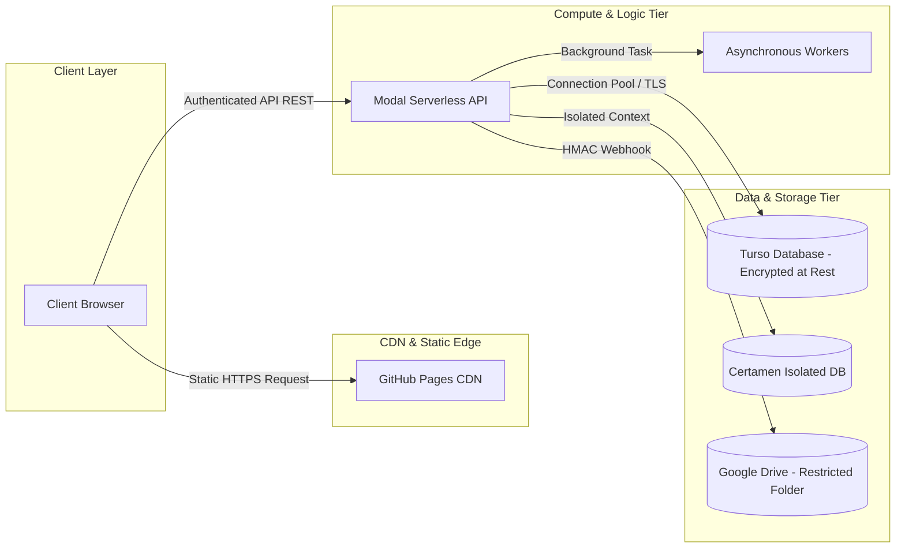

# Data Privacy, Security & Regulatory Compliance Specification

**Platform:** 72nd Annual CAJCL State Convention Platform (`state.uhsjcl.org`)  
**Operator:** California Junior Classical League (CAJCL), 501(c)(3) Non-Profit  
**Document Classification:** Regulatory & Operational Compliance Specification  
**Applicable Legal Frameworks:** COPPA (16 CFR Part 312), FERPA (34 CFR Part 99), SOPIPA (Cal. Bus. & Prof. Code § 22584), AB 1584 (Cal. Educ. Code § 49073.1), Cal. Civ. Code §§ 1798.81.5 & 1798.82  

---

## 1. Executive Summary & Governance Scope

This document defines the data privacy safeguards, architectural security boundaries, and regulatory compliance posture for the CAJCL State Convention digital platform under the **ID-Only Student Architecture** (with zero student names stored in the database and no chapter join codes).

### Statutory Applicability Matrix

| Regulatory Framework | Jurisdiction / Entity Threshold | Platform Applicability Determination | Compliance Strategy |
| :--- | :--- | :--- | :--- |
| **COPPA** (16 CFR Part 312) | Operators collecting PII online from children under 13. Excludes 501(c)(3) entities under FTC Act §5. | **Voluntary Full Adherence:** Middle school delegates include students aged 11–12. CAJCL enforces COPPA standards as industry best practice. | Zero student names/contact fields in DB; no join codes; explicit parental consent on physical waivers prior to login token distribution; dual-layer photo metadata stripping. |
| **FERPA** (34 CFR Part 99) | Educational agencies receiving federal funding. De-identified records safe harbor under 34 CFR § 99.31(b)(1). | **De-Identified Safe Harbor:** School sponsors keep the private `Assigned Delegate ID ↔ Student Name` Google Spreadsheet strictly at the school level (never shared with CAJCL). | Data strictly segregated by school; zero student names stored on the platform; no redisclosure to commercial third parties. |
| **SOPIPA** (Cal. Bus. & Prof. Code § 22584) | Operators of sites designed, marketed, and used primarily for K–12 school purposes. De-identified safe harbor under § 22584(g). | **Mandatory Compliance:** The system directly administers interscholastic K–12 academic competition activities. | De-identified student records; prohibition on student profiling, targeted advertising, or data monetization; 10-day backup expiration and April 12, 2027 purge. |
| **AB 1584** (Cal. Educ. Code § 49073.1) | Contracts between California LEAs (school districts) and third-party digital providers. Excludes de-identified data under § 49073.1(d)(2). | **Standard Addendum Availability:** Provides required statutory terms in the Privacy Policy for participating districts. | Standard student records addendum incorporated into Privacy Policy (§10). |

---

## 2. End-to-End Data Flow Architecture

### Data Flow Lifecycle Stages
1. **Public Browsing:** Anonymous visitors access pre-rendered HTML/CSS from GitHub Pages CDN. Public statistics (`/public/stats`) serve cached, pre-aggregated integer values without scanning identity tables.
2. **Authentication:** Attendee enters code `PPP-XXXXX-XXXXX`. Modal validates against `HMAC-SHA256(pepper, code)` in Turso. Adult accounts (`SPO-`, `VOL-`, and adult board roles, all aged 18+) additionally verify via an email two-factor authentication (2FA) one-time passcode sent via Google Apps Script. On success, a 256-bit cryptographically secure session token is issued; only its SHA-256 hash is retained.
3. **Sponsor-Managed Roster Provisioning (No Join Codes):** There are no chapter join codes. Chapter sponsors provision anonymous **Assigned Delegate IDs** for their chapter and track which Assigned Delegate ID corresponds to which student on a private Google Spreadsheet that is never shared with CAJCL or the platform.
4. **Digital Activity Sheets:** Chapter sponsors enter activity sheets by Assigned Delegate ID, or distribute individual `DEL-XXXXX-XXXXX` login tokens to students only after parents have signed the physical waiver and authorized the student to enter selections online. While student self-edits lock on **February 13, 2027**, February 13 is a soft deadline for sponsors, who can continue to update delegate records and fix mistakes afterward.
5. **Digital Contest Uploads:** Pre-convention creative submissions (art, essays, poetry) transmit via Modal to Google Drive via an authenticated webhook puppet. Files are hashed and stored with anonymized identifiers.
5a. **At-Convention Photo Contest:** During convention, delegates may upload one photo per category the Activities chair has opened (e.g. "Best flower photo"), with an optional caption, from their own phone. The browser (`frontend/public/js/pages/photos.js`) re-draws each photo onto an HTML5 canvas before sending it (≤2400 px JPEG + 480 px thumbnail), which removes location, camera, and time metadata; the server (`backend/lib/photos.py`) verifies magic bytes and strips JPEG `APP1` (EXIF/XMP), `APP13` (IPTC), and `COM` segments as well as PNG `eXIf`, `tEXt`, `iTXt`, `zTXt`, and `tIME` chunks. Files are named strictly by Chapter and Assigned Delegate ID. Only the Activities chair (scope `activities`) and Convention Presidents see photos inside the portal. A photo is deleted (Drive trash) when the student withdraws it, when the chair takes it down or deletes its category, or when the student is redacted.
5b. **Olympika Sign-Ups and the Convention Schedule:** Delegates or sponsors sign up for Olympika events by Assigned Delegate ID. The master convention schedule (`#/schedule`) is public and contains no personal data: Olympika appears on it only as event, heat or round, time, and place.
5c. **Activities Potluck:** The Activities chair posts activities that need helpers. Attendees tick the ones they would help run on their own sheet. Picks are deleted when the student is redacted, and with everything else on April 12, 2027.
6. **Double-Blind Judging:** Evaluators access contest files anonymized as `Entry N`. Assigned Delegate IDs, school chapters, and source filenames are programmatically stripped from judging views.
7. **Physical Medical Documentation (Zero-Ingestion Boundary):** Student/Adult medical records and signed liability forms are handled on paper and mailed to the host school (with PDF scans uploaded to a restricted Google Drive folder if requested). **No health records are stored in the application database.**
8. **Rolling Backups & Post-Convention Data Purge:** Automated database backups stored in Google Drive (daily before convention and every 15 minutes during convention) are automatically deleted after **10 days**. Exactly 30 days post-convention (**April 12, 2027**), all operational records, adult contact details, and uploaded files are permanently expunged, retaining only a de-identified statistical archive.

---

## 3. Information Classification & Data Inventory

| Classification Category | Data Fields Captured | Target Subjects | Ingestion Method | Retention Period |
| :--- | :--- | :--- | :--- | :--- |
| **De-Identified Delegate Records** | Assigned Delegate ID / Badge Number, Academic Grade (6–12), Chapter Affiliation, Latin Level | Student Delegates | Sponsor Roster Provisioning | De-identified from inception; operational records purged April 12, 2027 (rolling backups expire in 10 days) |
| **Academic & Event Data** | Latin Level, Testing Categories, Olympika Sign-Ups, Contest Submissions, Potluck Picks | Student Delegates | Sponsor or Authorized Student Form | Purged April 12, 2027 (De-identified counts archived) |
| **Photo Contest Entries** | Photograph (all EXIF/XMP/IPTC/GPS metadata stripped in browser and server), Optional Caption, Category, tagged by Chapter + Assigned Delegate ID | Student Delegates | Student's own upload at convention | Purged April 12, 2027 (Drive `Photo Contest` folder deleted); removed at once on withdrawal, takedown, or redaction |
| **Adult Contact Info** | Full Legal Name, Email Address (for 2FA), Mobile Phone, Chaperone Availability Notes | Sponsors, Chaperones, Board Advisors (all 18+) | Adult Form | Purged April 12, 2027 |
| **Cryptographic Auth** | Code HMAC, Adult Email 2FA Verification, Session Token SHA-256 Hash, Hashed IP, User-Agent | All Registrants | Automated / System Generated | Purged April 12, 2027 (Tokens expire in 180 days standard / 72 hours admin) |
| **Public Information Pages** | Text the board writes in Google Docs and publishes on the site (hotel list, white book, instructions). Contains NO registrant data; embedded images have metadata stripped via `photos.strip_metadata` | Board members (authors) | Administrator pastes Doc link; Apps Script converts it | Kept until the page is removed; not personal data |
| **Financial Accounting** | Check Number, Ledger Amount, Remittance Notes | Sponsoring Chapters | Administrative Entry | Retained for 501(c)(3) tax audit requirements (7 years) |

### Explicitly Excluded Data Elements (Deliberate Non-Collection)
- **Student Legal Names in Database:** Tracked strictly by Assigned Delegate ID; the private ID-to-name Google Spreadsheet stays with the Chapter Sponsor and is never shared with CAJCL.
- **Student Email Addresses & Phone Numbers:** System architecture strictly rejects delegate contact details; all communications route through adult sponsors.
- **Home Addresses & Social Security Numbers:** Never requested or accepted.
- **Birth Dates:** Student eligibility is governed strictly by academic grade (6–12).
- **Payment Card Data:** System accepts no electronic card processing; all fees remit via physical institutional checks.
- **Digital Health Records:** Zero medical data is stored on web database infrastructure.

---

## 4. Vendor Risk Assessment & Sub-Processor Matrix

| Sub-Processor | Service Role | Security Certification | Data Protection Agreement (DPA) | Data Transferred |
| :--- | :--- | :--- | :--- | :--- |
| **GitHub, Inc.** | Static CDN (Pages), CI/CD (Actions), Source Repo | SOC 1/2/3, ISO 27001 | Standard enterprise DPA | Static assets, visitor IP logs, CI encrypted secrets |
| **Modal Labs, Inc.** | Serverless Compute Backend, Asynchronous Workers | SOC 2 Type II, TLS 1.3, Encrypted at Rest | Standard platform DPA | Ephemeral compute payloads, API execution context |
| **Turso (ChiselStrike)**| Distributed libSQL (SQLite) Relational Database | SOC 2 Type II, AES-256 Volume Encryption | Standard platform DPA | De-identified student rows, adult profiles, authentication HMACs |
| **Google LLC** | Google Drive / Apps Script (Uploads, 2FA, Backups) | ISO 27001/27018, SOC 2/3 (Workspace infrastructure) | Google Cloud Data Processing Addendum (Workspace) | Contest digital files, photo contest images, 2FA emails, 10-day rolling backups, restricted waiver PDFs |

---

## 5. Technical & Organizational Safeguards (TOMs)

### Authentication & Access Control
- **Zero Cleartext Credentials:** Login tokens are salted and hashed using `HMAC-SHA256(CODE_PEPPER, code)`. The pepper resides exclusively in Modal Secrets.
- **Mandatory Adult Email 2FA (18+):** All adult sponsors, chaperones, and board members (who must be 18 or older) authenticate using email 2FA one-time passcodes alongside their Login Token.
- **Session Security:** Bearer tokens represent 256 bits of cryptographically secure pseudorandom entropy (`secrets.token_urlsafe(32)`), verified via SHA-256 hashing.
- **Brute-Force Rate Limiting:** Enforces maximum thresholds of 5 failed authentication attempts per code per hour and 10 failed attempts per IP per 15 minutes before triggering an HTTP 429 lockout.

### Network & Application Hardening
- **End-to-End Encryption:** Strict HTTPS enforcement across all endpoints with modern TLS 1.3 ciphers; AES-256 volume encryption at rest on Turso.
- **Security Headers:** Enforces `X-Frame-Options: DENY`, `X-Content-Type-Options: nosniff`, `Referrer-Policy: strict-origin-when-cross-origin`, and strict `Content-Security-Policy`.
- **SQL Injection Prevention:** 100% of relational queries utilize prepared, parameterized statements loaded from isolated `.sql` definitions in `backend/queries/`. Dynamic SQL formatting is forbidden and blocked in CI.
- **Cross-Site Scripting (XSS) Mitigation:** Frontend avoids `innerHTML` manipulation; all dynamic content is injected via safe DOM text node assignments (`document.createTextNode`) and HTML allowlist sanitization (`backend/lib/htmlclean.py`).
- **Immutable Transaction Logging:** Relational mutations enforce database-level checks requiring associated audit log generation (`audit_log`), preventing untracked administrative modifications.

---

## 6. Written Data Retention, Rolling Backup, & Purge Policy

Pursuant to COPPA § 312.10 and SOPIPA § 22584(d)(2), the platform follows the data lifecycle below:
- **Rolling Google Drive Backups (10-Day Retention):** Daily backups prior to convention and 15-minute backups during convention are stored in Google Drive and automatically deleted after **10 days**, ensuring that redacted records disappear from all backups within 10 days.
- **Mandatory Complete Purge Date (April 12, 2027):** Exactly 30 days after convention, all adult contact data, authentication/session hashes, uploaded contest files, Photo Contest folders, and any scanned waiver/medical PDFs in Google Drive are permanently expunged, leaving only de-identified aggregate and placement records (Year, Assigned Delegate ID, Chapter, Grade, Latin Level, Placements).

---

## 7. Written Information Security Program (WISP)

The Written Information Security Program required by Cal. Civ. Code § 1798.81.5 and COPPA § 312.8 is overseen by the **Host School Sponsor** (Mark Michalak, `state@uhsjcl.org`), who coordinates annual security reviews, access controls, vendor DPAs, retention/deletion verification, and incident response.

---

## 8. Incident Response & Breach Notification Protocol (Cal. Civ. Code § 1798.82)

In accordance with California Civil Code § 1798.82:
1. **Phase 1: Containment (Within 1 Hour)** — Invalidate compromised login tokens or session tokens and rotate secrets (`CODE_PEPPER`, Turso tokens, Modal tokens, Apps Script keys, and GitHub tokens).
2. **Phase 2: Forensic Impact Assessment (Within 24 Hours)** — Audit immutable `audit_log` records to identify exact records viewed or exfiltrated.
3. **Phase 3: Remediation & Isolation** — Patch discovered vulnerability and deploy verified hotfix via automated CI/CD pipeline.
4. **Phase 4: Legal, Institutional, & California Attorney General Notification (Within 30 Days)** — If unencrypted personal identifying information is confirmed exfiltrated, CAJCL will notify affected school district sponsors and families in writing without unreasonable delay, not to exceed 30 days. Pursuant to **Cal. Civ. Code § 1798.82(f)**, if a single breach requires notifying **more than 500 California residents**, CAJCL will also electronically submit a single sample copy of the breach notification notice (excluding PII) to the **California Attorney General**.
