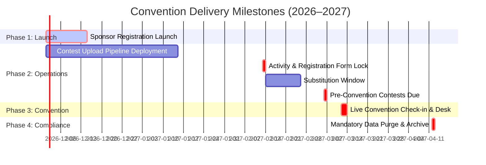

# Product Roadmap, Delivery Tracker & Milestone Governance

**Platform:** 72nd Annual CAJCL State Convention Platform (`state.uhsjcl.org`)  
**Target Release:** March 12–13, 2027  
**Document Classification:** Product Delivery & Milestone Management  

---

## 1. Executive Roadmap & Milestone Schedule

---

## 2. Work Breakdown Structure (WBS) & Delivery Tracker

### Milestone 1: Pre-Registration Launch (Target: December 1, 2026)
*Target: System open to ~50 school chapters for join-code and roster registration.*

| Work Item | Domain | Est. Hours | Lead | Dependencies / Blockers | Description & Implementation Notes |
| :--- | :--- | :--- | :--- | :--- | :--- |
| **Private GitHub Repository** | Security | 0.5 | Eng | GitHub Settings | Per CAJCL guidelines, ensure repository (especially backend server code) is private, not publicly accessible. |
| **Sponsor Email 2FA (One-Time Code)** | Security | 8 | Eng | `cajcl.org` Workspace Account | Implement email one-time code authentication on every sponsor sign-in (and confirm whether other adult/admin roles require it). |
| **Reliable Google Sheet Backup Sync** | Ops | 4 | Eng | Restricted Drive Sheet | Export/sync all critical registration data and schedule to a restricted Google Sheet in case of a website outage. |
| **Launch Email Broadcast** | Operations | 1 | PM | Updated Waiver & Privacy Policy (Mr. Muth) | Transmit launch notification template (`docs/REGISTRATION.md`) to verified chapter sponsors. |
| **WeasyPrint Remote Smoke Test** | Workers | 0.5 | Eng | Modal Deployment | Execute one remote PDF generation run on Modal Debian worker container to confirm Pango/Cairo rendering. |
| **Chapter & Sponsor Seeding** | Data | 2 | Ops | Official CAJCL Roster | Ingest 50 verified chapter institutions and primary sponsor profiles via `board.json` or dashboard. |
| **Roster Ingestion Sanitization** | Privacy | 2 | Eng | None | Strip discarded email and phone strings from raw pasted roster text before persisting to `roster_imports`. |
| **Join-Code & Consent Gate Check** | Product | 2 | Ops/Eng | Deployed migration 011 | Confirm each live chapter has a join code, update printed prose (`join_instructions`) to state join codes are distributed only after paper waiver/medical forms are turned in, and resolve adult join-code + identity-field locking questions (`docs/QUESTIONS.md`). |
| **Site Privacy Notice Update** | Privacy | 1 | Eng | Mr. Muth's CAJCL Privacy Policy | Update `frontend/public/js/pages/privacy.js` to match the paper-only waiver workflow, parental consent clause, and link/align with Mr. Muth's official CAJCL Privacy Policy. |
| **Certamen Practice Hardening** | Security | 3 | Eng | Decision on Arena Lifespan | Hash user PINs, enforce rate limits on login, and restrict question batch-deletion endpoints. |

---

### Milestone 2: Pre-Convention Operations (Deadlines: Feb 13 / Feb 26 / Mar 6, 2027)
*Target: Registration & activity sheets lock Feb 13; substitutions close Feb 26; pre-convention contests, scrapbook pictures, and publicity portfolio due Mar 6.*

| Work Item | Domain | Est. Hours | Lead | Dependencies / Blockers | Description & Implementation Notes |
| :--- | :--- | :--- | :--- | :--- | :--- |
| **Drive Upload Puppet Deployment** | Backend | 2 | Eng | Google Workspace Root Folder | Deploy `apps-script/Code.gs` to host Google Drive folder; configure `APPS_SCRIPT_URL` in Modal Secrets. |
| **Check Receipt Email Notification** | Backend | 2 | Eng | Apps Script / Email Service | Send automated email notification (in addition to website status) to sponsors when their registration check arrives. |
| **Contest Award Tiers & Deadlines Config** | Product | 1 | Ops | Academics Chair Input | Configure March 6 deadline for pre-convention contests/scrapbook pictures/publicity, March 13 10:00 AM for Digital Scrapbook, and awarded placement counts ($N$). |
| **Role-Based Judge Scoping** | Auth | 3 | Eng | Contest Division Rules | Bind `judge` scopes to specific contest categories to prevent cross-contest ballot evaluation. |
| **Awards / Scantron Check-In** | Product | 1 | PM | Mr. Muth (January check-in) | Confirm whether any modifications to the existing Scantron awards process are approved; plan post-convention sponsor test score viewing. |
| **Quota Pre-Flight Audit** | DevOps | 0.5 | Eng | None | Audit Turso row read metrics 30 days prior to event to confirm usage remains within free allowances. |

---

### Milestone 3: Convention Weekend Operations (March 12–13, 2027)
*Target: On-site check-in, walk-on handling, live brackets, convention features, scoring, and awards tabulation.*

| Work Item | Domain | Est. Hours | Lead | Dependencies / Blockers | Description & Implementation Notes |
| :--- | :--- | :--- | :--- | :--- | :--- |
| **Convention Book Website Features** | Product | TBD | Eng/PM | Scope decisions (`docs/QUESTIONS.md`) | Clarify and build/link features listed in Convention Book Page 4: interactive map, lost & found, candidate statements, feedback form, Graphic Arts voting, Open Certamen live brackets, Pandora's Breakout Box / That's Entertainment sign-ups, and volunteer obligation views. |
| **Written Tabulation Specifications**| Product | — | Board | Mr. Muth & Awards Chair | Formulate written rules for sweepstakes point tabulation, chapter aggregate scoring, and tie-breakers (defaulting to existing Scantron system unless modified). |
| **Offline Scoring Entry Tooling** | Frontend | 12 | Eng | Tabulation Rules | Deliver offline-capable scoring entry interface for athletic and academic competitions (most events remain on paper). |
| **Printable Badge & Certificate Gen**| Workers | 4 | Eng | Badge Stock Specifications | Deploy batch PDF rendering templates for attendee badge inserts and formal award certificates. |

---

### Milestone 4: Compliance Sunset & Data Decommissioning (April 12, 2027)
*Target: Complete purge of personally identifiable records exactly 30 days post-convention.*

| Work Item | Domain | Est. Hours | Lead | Dependencies / Blockers | Description & Implementation Notes |
| :--- | :--- | :--- | :--- | :--- | :--- |
| **Automated Data Purge Pipeline** | Compliance | 3 | Eng | Automated Export Validation | Execute `scripts/purge_convention_data.py`. Expunge student/adult PII, contest/photo Drive folders, Google Sheet backups, and temporary exports. |
| **De-Identified Archive Extraction**| Data | 2 | Eng | Post-Event Verification | Export permanent historical competition archive: Badge ID, Chapter, Grade, Latin Level, Placements. |
| **Sponsor Results Distribution** | Operations | 2 | Ops | Tabulation Finalization | Distribute individual school placement/test score reports directly to chapter sponsors (no public awards lists with student names). |

---

## 3. Product Boundaries & Scope Exclusions

The following features have been evaluated and deliberately excluded (or flagged for scope reconciliation) from the current product scope:

| Feature / Request | Determination | Architectural Rationale |
| :--- | :--- | :--- |
| **Interactive Campus Navigation** | **Re-evaluating** | Previously out of scope, but the 2027 Convention Book (Page 4) lists "View interactive map/schedule" during convention. Confirm lightweight static/linked map approach (`docs/QUESTIONS.md`). |
| **Push Notification Schedules** | **Out of Scope** | Delegate privacy rules prohibit student contact information; delegates read the Schedule page or the printed schedule. |
| **Reversible Credential Encryption**| **Rejected** | Storing reversible login tokens compromises security posture; selective reissuance addresses lost credentials safely. |
| **Inter-Chapter Student Transfers** | **Rejected** | Cross-school transfers violate institutional billing and Latin level eligibility constraints; drop-and-readd is required. |
| **Automated Financial Refunds** | **Rejected** | Convention budget operates on firm pre-payment terms; accounting reconciles via `cancelled_paid` state. Substitutions allowed through February 26, 2027. |

---

## 4. Key Stakeholder Decisions Required

See [`docs/QUESTIONS.md`](QUESTIONS.md) for the complete list of open questions for collaborators. High-priority decisions:
1. **Google Sheet Alternative Registration Path:** Decide whether to offer a parallel Google Sheet registration option alongside the website (per Mr. Muth's email) and how it syncs into the single database.
2. **Adult Join Codes & Identity Field Locking:** Confirm whether adults (SCL, Sponsors, Chaperones) join via join code as described in the Convention Book, and verify locking of student name/grade/Latin level after initial entry.
3. **Google Workspace Account & Vendor Vetting:** Provision official CAJCL Google Workspace account (`conventionpresidents@cajcl.org`) and obtain adult sign-off on all third-party tools handling PII (Modal and Turso are approved; confirm GitHub, Google Drive/Apps Script, Blooket/Kahoot, Goose Chase, etc.).
4. **Awards & Scantron Process:** Schedule January check-in with Mr. Muth on awards tabulation and post-convention sponsor test score viewing.

---

## 5. Architectural Invariants (Protected Patterns)

The following core patterns are tested and must not be refactored without executive review:
- **Idempotent Roster Submissions:** Roster commits require signed tokens binding payload hash and target roster fingerprint.
- **Transactional Counter Aggregates:** Statistical metrics and invoices update within mutation transactions; live full-table scans are forbidden.
- **Thread-Local Connection Pooling:** Database connection handles are pooled strictly per-thread with automatic disposal hooks, preventing cross-thread SQLite panics.
- **Strict Role-Based Scope Assignment:** Permissions bind exclusively to roles; no permissions may be assigned directly to user records.
